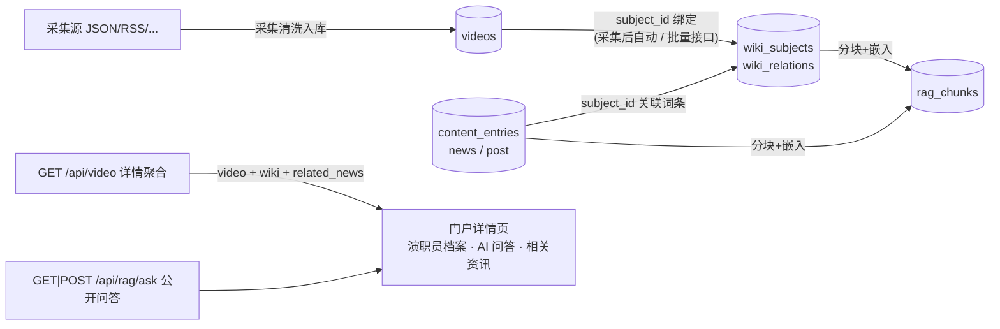

# Wiki / RAG / 影视详情 / 资讯 数据串联

本文描述 采集 → Wiki 知识库 → RAG 索引 → 详情页聚合 的完整链路，以及为此新增/调整的接口。

## 架构总览



枢纽实体是 **Wiki 词条（wiki_subjects）**：

- `videos.subject_id`：视频 ↔ 作品词条（同步时自动建立；详情页读取时若未绑定会按片名精确匹配并幂等回填）。
- `content_entries.subject_id`：资讯/社区帖 ↔ 任意词条（作品或人物），管理端发布时指定。
- RAG 向量块的 `subject_id`：词条块、关系块与关联了词条的资讯块都携带，检索命中即可回链实体。

## 采集后自动串联

视频入库成功后，调度器异步触发 Wiki 同步（按名称查重、幂等），随后重建该词条邻域的 RAG 索引：

- 环境变量 `WIKI_AUTO_SYNC=0` 可关闭（默认开启）。
- 同步在单工作队列中串行执行，避免并发同步为同一人物创建重复词条。
- 历史视频可批量补齐：`POST /api/admin/wiki/sync-videos {"all": true}`（或 `{"video_ids": [..]}`，单次上限 500，可重复执行）。

## 接口清单

### 变更（向后兼容）

| 接口 | 变更 |
| :--- | :--- |
| `GET /api/video`、`GET /api/video/detail` | 响应新增 `wiki`（词条详情含 `forward_relations`/`reverse_relations`/`linked_videos`）与 `related_news`（该词条已发布资讯，最多 6 条）；未关联词条时两字段为 `null`/空 |
| `GET /api/wiki/subject` | 响应新增 `related_news`（最多 10 条） |
| `GET /api/news`、`GET /api/community/posts` | 支持 `subject_id` 查询参数过滤 |
| `GET /api/news?id=`、`GET /api/community/posts?id=` | 详情响应新增 `author_subject`：作者显示名与 Wiki 人物词条同名时返回该词条（仅用于作者跳转，未命中为 `null`） |
| `POST/PUT /api/admin/news`、社区帖管理 | 请求体支持 `subject_id`（仅管理员），词条不存在时返回 400；保存后自动触发 RAG 索引 |
| `POST /api/feedback` | 请求体新增 `target_type`（白名单：`video`/`news`/`post`/`wiki_subject`）与 `target_id`，作为纠错上下文；`GET /api/feedback`（管理员）返回同样字段 |

### 新增

| 接口 | 说明 |
| :--- | :--- |
| `POST /api/admin/wiki/sync-videos` | 批量同步视频库 → Wiki 词条与人物图谱，body `{"all": true}` 或 `{"video_ids": [..]}`，返回逐条结果 |
| `GET\|POST /api/rag/search` | 公开语义检索（`q`、`top_k`≤20、`source_type`），响应含 `refs` 实体跳转引用 |
| `POST /api/rag/ask` | 公开知识问答。配置了 `OPENAI_API_KEY` 时返回 `mode:"chat"` 与生成答案；未配置时自动降级为 `mode:"retrieval"`（返回命中片段 + 引用 + `note`），不再报错 |

`refs` 中：`news` → `/news/:id`、`post` → `/community/:id` 可直接跳转；`wiki_subject`/`wiki_relation` 提供 `subject_id` 与 `title`（门户词条页为 `/wiki/:id`）。

## 门户页面

- **番剧详情页 `/anime/:id`**：头部新增「Wiki 词条」徽章；新增「演职员档案」（按声优/导演等关系类型分组，来自 Wiki 关系）；「问问 AI 使魔」（调 `/api/rag/ask`，展示检索模式提示与可跳转引用）；「相关资讯」（`subject_id` 关联的资讯）。
- **词条档案页 `/wiki/:id`**（新增，`/wiki-subject/:id` 同样可用）：属性卡、摘要、关系网络、可观看正片、相关资讯。
- **资讯详情页 `/news/:id`**：内容前展示「关联词条」卡片，可跳转词条档案或直接去观看。

SSR 首屏注水（`web/embed.go`）与 `/api/video` 聚合逻辑一致：详情页首屏即包含 Wiki 与资讯数据，无需二次请求。

## Flutter App 端

App 与 Web 端消费同一套聚合接口（`video-collection-app/`）：

| 文件 | 内容 |
| :--- | :--- |
| `lib/models/wiki_model.dart` | `WikiSubject` / `WikiRelation` / `RagCitation` / `RagAskResult` 模型，对空数据安全 |
| `lib/services/api_service.dart` | `getVideoDetail` 解析聚合响应中的 `wiki` 与 `related_news`；新增 `getWikiSubject`、`ragAsk`（30s 超时） |
| `lib/screens/anime_detail_screen.dart` | 详情页：头部「Wiki 词条」徽章跳词条档案；「角色介绍」优先使用 Wiki 关系（人物卡可点击进入词条）；「问问 AI 使魔」入口卡 + 头部 AI 按钮（`showRagAskSheet`）；「相关资讯」横滑卡；动作行纠错按钮 |
| `lib/widgets/rag_ask_sheet.dart` | AI 问答底部弹层：问答输入、检索模式提示、引用 chips（可跳资讯/词条） |
| `lib/widgets/report_dialog.dart` | 纠错弹窗（详情/词条/资讯复用），提交 `POST /api/feedback` 并携带纠错对象 |
| `lib/screens/wiki_subject_screen.dart` | 词条档案页：属性卡、关系网络（可跳转词条）、可观看正片（跳详情页）、相关资讯；AppBar 纠错入口 |
| `lib/screens/content_detail_screen.dart` | 资讯详情：`subject_id` 关联词条时展示关联卡（有正片显示「去观看」）；作者命中人物词条时显示「词条 ›」可点击跳转；纠错入口 |

调试包连接测试环境：`flutter run -d windows --dart-define=API_BASE_URL=http://127.0.0.1:8090`（或在「设置」中修改 API 地址）。模型解析测试见 `test/wiki_model_test.dart`。

## 作者 / 演职员跳转

- **详情页演职员**：番剧详情页「演职员档案」中的每个人名（含角色描述）都可点击，进入该人物的词条档案（参演作品、关系网络、相关资讯）。App 端「角色介绍」人物卡同样可点击。
- **资讯/动态作者**：作者显示名与某个人物词条同名时，资讯与社区动态详情页的作者区域会出现「词条 ›」徽章，点击进入人物词条页。匹配在详情接口按名解析（`author_subject`），无需发布时额外配置；未命中则正常展示。
- 演职员词条页内「可观看的正片」直接跳播放详情，形成 作品 → 人物 → 作品 的双向浏览闭环。

## 纠错与编辑

**纠错（所有访客）**：Web 门户与 App 的番剧详情、资讯/动态详情、词条档案页均提供「纠错」入口（Web 为按钮/链接，App 为图标按钮与弹窗）。提交后进入通用反馈通道：

- `POST /api/feedback`，`type=report`，携带 `target_type` + `target_id`（白名单校验），标题自动带【纠错】前缀与对象名。
- 管理员在管理后台「用户反馈」页看到纠错对象与说明，处理后答复（流程与普通反馈一致）。

**编辑（管理员）**：

- Wiki 词条与关系：管理后台 `/admin` →「Wiki 知识库」，支持增删改词条、维护关系与从视频库同步；改动会自动触发 RAG 重索引。
- 视频信息：后台「视频库」编辑；资讯/动态：后台资讯管理。
- 客户端（门户/App）不提供直接编辑入口，所有修改经纠错反馈进入后台处理后由管理员执行，保证变更可审计。

## 嵌入与对话模型

| 环境变量 | 作用 |
| :--- | :--- |
| `RAG_EMBEDDING_PROVIDER` | `openai` 或默认本地伪向量（离线可跑通） |
| `OPENAI_API_KEY` / `OPENAI_BASE_URL` | 同时决定嵌入与对话；未配置时 ask 自动降级为检索模式 |
| `RAG_CHAT_MODEL`、`RAG_CHAT_SYSTEM_PROMPT`、`RAG_CHAT_MAX_TOKENS`、`RAG_CHAT_TIMEOUT_SEC` | 对话模型行为 |
| `WIKI_AUTO_SYNC` | `0` 关闭采集后自动同步 |

本地伪向量模式下，检索在余弦相似度上叠加了 bigram 重叠混合加成（`hybridBoost`），作品名+疑问词的短查询也能命中正确实体；接入远程嵌入后同样有益。

## 测试数据（端到端）

`tmp/testdata/` 提供了一套本地测试采集源与造数脚本：

| 文件 | 用途 |
| :--- | :--- |
| `vod_source.json` | 苹果CMS 格式测试源：4 部作品、共享演员形成关系网、公开测试流播放地址 |
| `serve.go` | `go run ./tmp/testdata/serve.go` 在 `127.0.0.1:8931` 提供该 JSON（任意路径/参数同响应） |
| `source.json` / `news1..3.json` / `ask_query*.json` | 通过管理 API 创建采集源、关联词条的资讯与问答测试体 |

端到端流程（管理端登录后）：

```bash
# 1. 创建采集源并全量采集（入库后自动生成 Wiki 词条 + RAG 索引）
curl -X POST /api/admin/sources -H "Content-Type: application/json; charset=utf-8" --data-binary @tmp/testdata/source.json -H "Authorization: Bearer $TOKEN"
curl -X POST /api/admin/sources/collect -H "Authorization: Bearer $TOKEN" -d '{"source_id":"e2e_test_json","hours":0}'
# 2. 创建关联词条的资讯
curl -X POST /api/admin/news --data-binary @tmp/testdata/news1.json ...
# 3. 全量重建 RAG 索引
curl -X POST /api/admin/rag/rebuild
# 4. 验证详情聚合与公开问答
curl "http://127.0.0.1:8090/api/video?id=1"
curl -X POST http://127.0.0.1:8090/api/rag/ask --data-binary @tmp/testdata/ask_query.json
```

> [!NOTE]
> 在 Windows 终端里直接用 `curl -d '含中文的 JSON'` 会因控制台编码把中文写坏；中文请求体请使用 UTF-8 文件加 `--data-binary @file` 发送。
